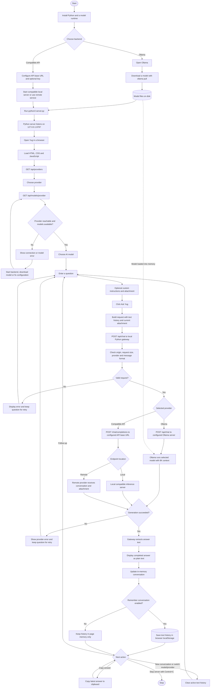
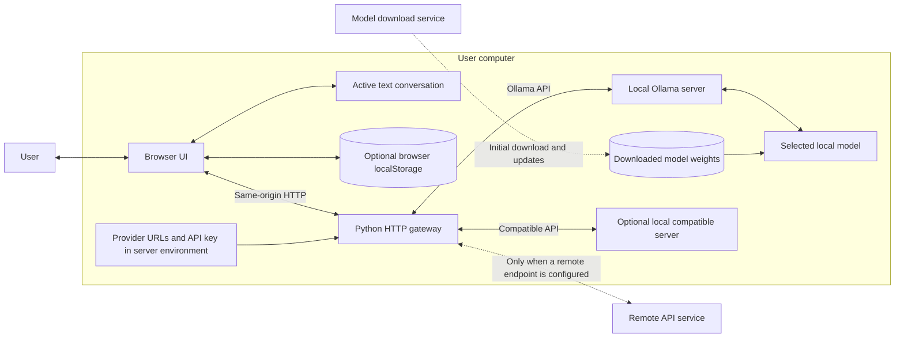

# Yug Native AI — Application Flow

This diagram describes the implemented application. GitHub renders the Mermaid code blocks directly in Markdown files.

## Complete flow

## Architecture and data boundaries

## Important implementation details

- **Default addresses:** Yug UI `http://127.0.0.1:8787`; Ollama `http://127.0.0.1:11434`. Both are configurable. Yug itself binds to loopback only.
- **Model discovery:** Ollama uses `GET /api/tags`; the compatible adapter uses `GET /models` relative to its configured base URL, normally ending in `/v1`.
- **Generation:** Requests use `stream: false`. The UI displays the completed answer; streaming is not implemented.
- **Conversation:** Each request includes custom instructions and prior text messages. History is capped at 18 exchanges after a successful response. Provider/model changes clear the active conversation.
- **Text attachments:** Files must be under 5 MB. Up to 24,000 characters are appended directly to the current question and become part of text history. This is not document indexing or retrieval.
- **Images:** One PNG, JPEG or WebP image is sent for the current question only. The model and provider must support vision. Images are not retained for follow-ups.
- **Persistence:** Optional saved text history lives in browser localStorage. The Python server has no chat database. Selected model and custom instructions are not restored after reload.
- **Credentials:** The optional compatible API key stays in the server environment; it is not returned to the UI.
- **Privacy:** Local inference stays on the computer when a local model and local endpoint are used. A remote endpoint receives submitted conversation data. Ollama cloud models also involve remote processing.
- **Separate lifecycle:** Stopping Yug does not stop Ollama or delete its downloaded models. Clear saved history separately from removing model files.

## Future extensions — not implemented

Web search, indexed document retrieval with citations, PDF parsing, voice, video processing, code execution, autonomous tool use, hardware-based model recommendations, and one-click packaged installation are possible extensions. They are not part of the current application flow.

See [README.md](README.md) for setup and usage.
