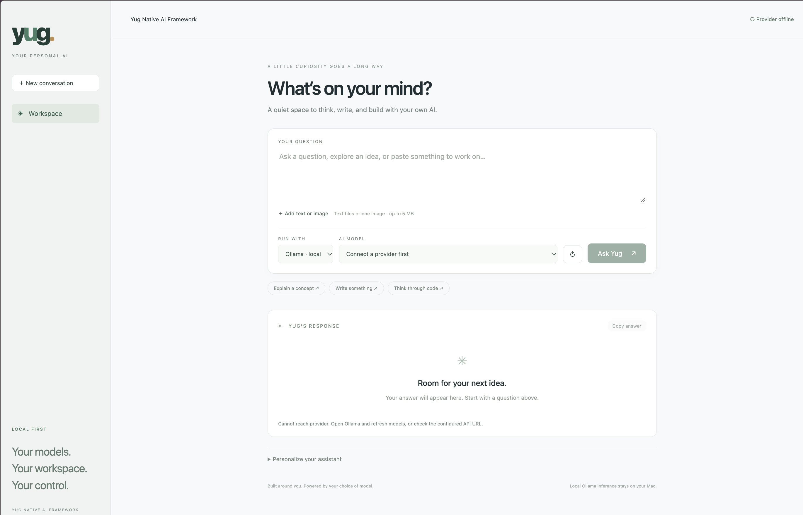
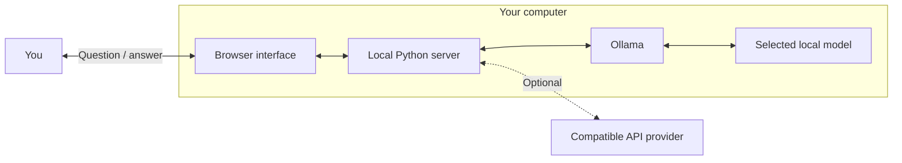

# Yug Native AI Framework

**A simple, local-first workspace for chatting with your choice of AI model.**

Type a question, choose a provider and model, and read the answer below. Run models through Ollama on your own computer, or connect another compatible API.

[Getting started](#getting-started-on-macos) · [How to use](#how-to-use) · [Configuration](#configuration) · [Troubleshooting](#troubleshooting) · [License](#license)

## Screenshot



*Workspace preview before connecting Ollama. The screenshot shows the provider offline; start Ollama and select a downloaded model to generate answers.*

## Features

- Simple query box, provider/model dropdowns, and answer area.
- Automatic discovery of models installed in Ollama.
- Switch between Qwen and other installed models.
- Optional OpenAI-compatible API backend, such as a configured LM Studio server.
- Multi-turn conversations, new conversation button, and copy answer button.
- Custom assistant instructions.
- Optional saved text conversation in your browser.
- Text/code attachments and one image per question with a compatible vision model.
- Responsive interface with no external fonts, scripts, or frontend dependencies.

## How it works

See [the complete application flow and architecture diagrams](ARCHITECTURE.md) for startup, requests, provider routing, and storage details.



Ollama manages the model downloads and inference. Yug provides the interface, conversation context, custom instructions, and provider connection. This project uses existing models; it does not train a new model.

## Requirements

| Item | Requirement |
| --- | --- |
| Python | Python 3.10 or newer |
| Browser | A modern browser, such as Brave, Safari, Chrome, or Firefox |
| Local model runtime | Ollama, installed and running |
| macOS for Ollama | macOS Sonoma 14 or newer |
| Internet | Needed for installation and model downloads; local text chat can work offline afterward |
| Model resources | Enough memory and disk space for the selected model |

For Qwen3.5 35B, plan for an approximately **22 GB model download**, additional runtime memory, and at least **35–40 GB of free disk space** as practical headroom. An Apple Silicon Mac with 48 GB unified memory is a reasonable starting point for this quantized model with the app's 8K context. Actual performance depends on available memory and workload.

No pip packages, Node.js, Docker, Brave integration, or paid API subscription are required for the local setup.

## Getting started on macOS

### 1. Download the project

On GitHub, choose **Code → Download ZIP**, then extract it. Alternatively, clone the repository using its actual GitHub clone URL.

Open the folder containing `server.py`, `README.md`, and the `web` directory. These files should be together in the project root.

### 2. Install Python

Open Terminal and check your version:

```bash
python3 --version
```

If Python is missing or older than 3.10, install a current Python 3 release from [python.org](https://www.python.org/downloads/macos/), then open a new Terminal window.

### 3. Install and open Ollama

Download the macOS application from [ollama.com](https://ollama.com/download/mac), install it in Applications, and open it. Complete its command-line setup if prompted.

Verify in Terminal:

```bash
ollama --version
```

### 4. Download a model

For Qwen3.5 35B:

```bash
ollama pull qwen3.5:35b
```

For a smaller alternative:

```bash
ollama pull qwen3.5:4b
```

Choose a model that fits your computer. You only need to download the models you want to use.

Check installed models:

```bash
ollama list
```

### 5. Start Yug

In Terminal, type `cd `, drag the extracted project folder into Terminal to insert its path, and press Return. Then run:

```bash
python3 server.py
```

You should see:

```text
Yug Native AI Framework → http://127.0.0.1:8787
```

Open **[http://127.0.0.1:8787](http://127.0.0.1:8787)** in your browser.

You can also double-click `Start Yug.command` on macOS. If the launcher is not executable after downloading, run `chmod +x "Start Yug.command"` from the project folder, or use the Python command above.

Keep the Terminal window and Ollama running while using the app. Press **Control+C** in Terminal to stop Yug.

## How to use

1. Choose **Ollama · local** under **Run with**.
2. Click the refresh button if your installed models are not listed.
3. Select a model from **AI model**.
4. Enter your question in the text box.
5. Click **Ask Yug**. The answer appears in **Yug's response**.
6. Ask a follow-up question to continue the conversation.

The first answer may take longer while the model loads. Responses appear when generation finishes; token-by-token streaming is not implemented.

### Start a new conversation

Click **New conversation** to clear the current conversation. Selecting another provider or model also starts a new conversation. This clears Yug's active text history; it does not remove downloaded models.

### Customize the assistant

Expand **Personalize your assistant** and edit **Assistant instructions**. For example:

```text
You are my coding tutor. Explain in simple language, give small examples,
and tell me when you are uncertain.
```

These instructions guide subsequent requests. They do not retrain the model. Custom instructions are not saved across page reloads.

### Attach text or code

Click **Add text or image** and choose a supported text file, such as `.txt`, `.md`, `.csv`, `.json`, `.py`, `.js`, or `.sql`. Ask a question about it, then submit.

Files must be under 5 MB. Up to the first 24,000 characters of a text attachment are included directly in the question. This is not a searchable document library, and PDF/Word parsing is not included.

### Ask about an image

Select a vision-capable model, attach one PNG, JPEG, or WebP image under 5 MB, and enter a question about it.

Image support depends on the chosen model and provider. Images are sent only for the current question and are not saved or resent with subsequent questions.

### Save or copy a conversation

- Click **Copy answer** to copy the latest answer.
- Enable **Remember conversation on this browser** to save text history locally in that browser.
- Disable it to remove the saved history for this app.

Saved history is specific to the browser and site address. It is not encrypted by the application or synchronized across devices. Reloading restores the saved text conversation and latest answer, but not the selected model or custom instructions; check those before continuing. Prior text history is capped at 18 exchanges.

## Configuration

The following environment variables are optional. Set them in the same Terminal session before starting `python3 server.py`.

| Variable | Default | Purpose |
| --- | --- | --- |
| `YUG_PORT` | `8787` | Local web interface port |
| `YUG_OLLAMA_URL` | `http://127.0.0.1:11434` | Ollama server base URL |
| `YUG_COMPAT_URL` | Not set | Additional compatible API base URL, normally ending in `/v1` |
| `YUG_COMPAT_KEY` | Not set | API key for that compatible provider, if required |

### Connect a compatible API

For example, after separately starting a compatible LM Studio server:

```bash
export YUG_COMPAT_URL="http://127.0.0.1:1234/v1"
python3 server.py
```

Select **Compatible API** in the provider dropdown. The backend must implement `GET /models` and `POST /chat/completions` with compatible request/response formats.

For a remote service requiring authentication, set `YUG_COMPAT_URL` to its documented base URL and `YUG_COMPAT_KEY` to your credential before starting the app. Keep credentials out of source files, screenshots, and Git commits. The application does not automatically load `.env` files.

### Change the UI port

```bash
export YUG_PORT=8788
python3 server.py
```

Then open `http://127.0.0.1:8788`.

### Adjust context size

The Ollama adapter requests an 8,192-token context. Developers can change `num_ctx` in `server.py`. Longer contexts need more memory; large attachments and conversations may exceed this limit.

## Privacy and scope

- The web server listens only on `127.0.0.1`.
- When using a local Ollama model, inference runs on your computer. Ollama cloud models and remote endpoints have different data flows.
- A remote provider receives the submitted conversation, instructions, and attachment for that request.
- API keys remain in the server environment and are not returned to the browser.
- The Python server has no chat database. Optional text history lives in browser localStorage.
- This is a local development application without accounts or authentication. It is not configured for public hosting.

## Current limitations

Web search, indexed document retrieval, PDF parsing, video processing, speech, code execution, autonomous actions, and semantic long-term memory are **not implemented**. Model capabilities alone do not add these integrations. Responses are displayed as plain text, including code and Markdown notation, and may contain mistakes.

## Troubleshooting

| Problem | What to do |
| --- | --- |
| Provider offline | Open Ollama, confirm its configured URL, and refresh models. |
| No models installed | Run `ollama pull qwen3.5:35b` or download a smaller model, then refresh. |
| `ollama: command not found` | Open Ollama and complete its command-line setup; reopen Terminal. |
| `python3: command not found` | Install Python 3 and reopen Terminal. |
| Port already in use | Stop the other Yug instance or set a different `YUG_PORT`. |
| Slow answers or memory pressure | Close heavy applications, try a smaller model, or start a new conversation. |
| Image request fails | Confirm the model and provider support images; use PNG, JPEG, or WebP. |
| Remote API returns an error | Check its base URL, API key, available models, and Chat Completions compatibility. |
| Page opens before the server is ready | Wait for the server address in Terminal, then reload the page. |

To check which model is loaded:

```bash
ollama ps
```

To release a model from memory, use its actual model name:

```bash
ollama stop qwen3.5:35b
```

## Project structure

```text
yug-native-ai/
├── README.md
├── LICENSE
├── THIRD_PARTY_NOTICES.md
├── .gitignore
├── Start Yug.command
├── server.py          # Local HTTP server and provider adapters
├── test_server.py     # Mock-provider integration tests
└── web/
    ├── index.html     # Interface structure
    ├── style.css      # Responsive styling
    └── app.js         # Chat, model selection, attachments, local history
```

## Development and tests

Run from the project root:

```bash
python3 -m unittest discover -s . -p test_server.py
```

Tests use a mock provider to verify model discovery, chat payloads, image routing, compatible API routing, errors, and origin checks. They do not download or run a real AI model. Real-model quality and performance require separate testing with your chosen runtime and weights.

Add provider adapters in `server.py` and interface changes in `web/`. Future retrieval, search, voice, and tool integrations can be added around the existing chat gateway.

## License

Copyright (c) 2026 Yug Native AI Framework contributors.

The framework code and documentation are available under the **[MIT License](LICENSE)**. Retain the license and copyright notice when redistributing. The software is provided without warranty.

Model weights, runtimes, and services have their own licenses and terms. They are not bundled or relicensed by this project. See [THIRD_PARTY_NOTICES.md](THIRD_PARTY_NOTICES.md).

## Publishing on GitHub

Place **the contents of this project folder at the repository root**, including this file named exactly `README.md`. GitHub will render it on the repository's main page when viewing the branch containing it.

Before publishing, review tracked files and history for credentials, personal data, logs, attachments, and model files. Include `LICENSE`, `THIRD_PARTY_NOTICES.md`, and `.gitignore`. The ignore file does not remove files already committed.

This README describes the application; it does not host or run the Python backend. GitHub Pages cannot run this server. Users run it locally using the steps above.
